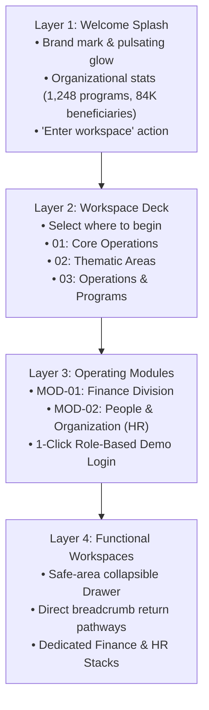

# Pantiss ERP — Technical Architecture & Project Documentation

> **Mission**: A unified, high-integrity enterprise resource planning system tailored for non-profit organizations, rural development missions, and vocational skilling programs.

---

## 1. Executive Summary & Why Pantiss ERP Was Built

### 1.1 The Problem
Non-profit organizations and development sector consortia managing large-scale, grant-funded interventions face operational challenges distinct from traditional commercial enterprises:
- **Multi-Thematic Disconnect**: Operations are split across diverse intervention tracks (Vocational Skill Development, Rural Livelihoods, Community Healthcare & Nutrition, Micro-Entrepreneurship, Sanitation, and Policy Research). Traditional corporate ERPs treat these as cost centers rather than programmatic delivery ecosystems.
- **Grant Utilization & Compliance Friction**: Donors require strict three-way audit trails linking purchase orders, vendor invoices, delivery store records (GRNs), and payment references (bank UTRs). Disconnected spreadsheets lead to compliance exceptions, reporting delays, and audit vulnerabilities.
- **Field-to-Headquarters Latency**: Operating centers are distributed across rural districts (e.g., Odisha, Jharkhand, Chhattisgarh) where field staff file travel claims, center rental expenses, and daily attendance on mobile devices.
- **Over-Engineered Commercial Software**: Off-the-shelf enterprise software often suffers from slow load times, confusing navigation, visual clutter, and lack of offline-resilient or mobile-optimized workflows.

### 1.2 The Solution
**Pantiss ERP** delivers a connected, high-performance workspace spanning both mobile and desktop. It bridges administrative governance with grassroots impact tracking:
1. **Financial Stewardship**: Real-time budget allocation monitoring, grant utilization velocity, automated salary payroll approval, vendor procurement with competitive quote selection, and employee invoice audit trails.
2. **People & Organizational Talent**: Recruitment pipeline, automated offer letter generation, employee onboarding, thematic project deployment, photo-verified attendance, leave management, and year-end KBI (Key Behavioural Indicator) appraisals.
3. **Audit-Grade Traceability**: Every transaction maintains full chronological audit entries detailing the actor, timestamp, action taken, and supporting document links.

---

## 2. Technology Stack & Architectural Decisions

```
+--------------------------------------------------------------------------+
|                              PRESENTATION                                |
|  React Native 0.88 · Expo SDK 58 · React Compiler · Reanimated 4         |
+--------------------------------------------------------------------------+
                                     │
+--------------------------------------------------------------------------+
|                          NAVIGATION & ROUTING                            |
|  React Navigation 7 (Native Stacks + Responsive Modal/Drawer)            |
|  Flow: Welcome Splash ──> Workspace Deck ──> Modules ──> Finance / HR    |
+--------------------------------------------------------------------------+
                                     │
+--------------------------------------------------------------------------+
|                             DESIGN SYSTEM                                |
|  Dark-First OLED UI · Tailwind Zinc Palette · Soothing Tactile Haptics   |
+--------------------------------------------------------------------------+
                                     │
+--------------------------------------------------------------------------+
|                       STATE & DATA LAYER                                 |
|  Modular Domain Stores · Local Persistence · Optimistic UI Updates       |
+--------------------------------------------------------------------------+
                                     │
+--------------------------------------------------------------------------+
|                         BUILD & RUNTIME                                  |
|  Hermes Bytecode Engine · R8 Code/Resource Shrinking · 36MB Release APK  |
+--------------------------------------------------------------------------+
```

### 2.1 Core Technologies
- **Framework**: [React Native](https://reactnative.dev/) `0.88.0` with [Expo](https://expo.dev/) `~58.0.0`
- **Compiler**: React Compiler enabled (`experiments.reactCompiler: true`) for automatic memoization without runtime overhead.
- **Language**: [TypeScript](https://www.typescriptlang.org/) `~5.9.2` in strict mode.
- **Navigation**: [React Navigation 7](https://reactnavigation.org/) utilizing `@react-navigation/native-stack` and `@react-navigation/drawer` for 60fps native transitions.
- **Animations & Micro-interactions**: [React Native Reanimated](https://docs.swmansion.com/react-native-reanimated/) `~4.2.1` and [React Native SVG](https://github.com/software-mansion/react-native-svg) `15.15.1`.
- **Haptic Feedback**: [Expo Haptics](https://docs.expo.dev/versions/latest/sdk/haptics/) configured with soothing light impacts.
- **Storage**: Asynchronous persistent storage utility (`@pantiss_erp:*`) for authentication sessions, theme preference, offline budget drafts, and procurement history.

### 2.2 Hermes & Native Android Optimization
The Android binary is engineered for speed, low memory footprint, and quick startup on mid-range Android devices common in field operations:
- **Hermes JavaScript Engine**: Precompiles JavaScript source code into compact Hermes bytecode during build time, slashing Time-to-Interactive (TTI).
- **R8 Minification & Resource Shrinking**:
  - `minifyEnabled true`: Shrinks unused Java/Kotlin code and obfuscates class paths.
  - `shrinkResources true`: Strips unreferenced drawable, layout, and string assets.
- **ABI Split (`arm64-v8a`)**: Produces a modern 64-bit ARM architecture APK sized at **~36 MB**, avoiding bloated universal APK overhead.

---

## 3. Application Flow & Navigation Architecture

The app is intentionally structured into an intuitive, sequential 4-layer information architecture:



### 3.1 Flow Breakdown
1. **Welcome Screen (`src/screens/welcome/WelcomeScreen.tsx`)**:
   - First screen presented on app launch.
   - Features animated orbital telemetry lines, leaf brand mark with subtle breathing radial gradient glow, and live non-profit metrics (*Total Programs: 1,248*, *Beneficiaries: 84,309*, *Active Donors: 3,720*).
   - Tapping **"Enter workspace →"** provides a soothing tactile feedback tick and navigates to the Workspaces screen.
2. **Workspace Selection (`src/screens/landing/LandingScreen.tsx`)**:
   - Presents the high-level operational groupings: *Core Operations*, *Thematic Areas*, and *Operations & Programs*.
   - Includes a top bar with a back button allowing the user to return to the Welcome screen, theme switch, and user avatar.
3. **Module Selection (`src/screens/modules/ModulesScreen.tsx`)**:
   - Displays available modules within the chosen workspace (e.g., Finance Division and Human Resources).
   - Shows live operational metrics and status pills.
   - Secure organizational entry dialog with 1-click test credentials to jump straight into active workflows.
4. **Functional Workspaces (`FinanceStack` & `HrStack`)**:
   - Full-featured, drawer-backed workspaces.
   - Includes a top drawer option `← All Workspaces & Modules` enabling instantaneous return to any operational tier.

---

## 4. UI/UX Philosophy & Design System

### 4.1 Dark-First OLED Aesthetics
- **Default Theme**: Dark (`#09090b` background / `#0f172a` card surfaces).
- **Field Legibility**: High-contrast typography with emerald (`#10b981`), teal (`#14b8a6`), and rose (`#f43f5e`) accent highlights, ensuring effortless readability under varying outdoor lighting conditions.
- **Dynamic Switching**: Supports dynamic switching between dark and light modes via a synchronized theme toggle.

### 4.2 Soothing Tactile Haptic System
Haptic feedback is calibrated to feel premium, subtle, and calming:
- **`haptics.selection()`**: Soft tactile tick for chip filters, tab toggles, and radio selections.
- **`haptics.light()`**: Gentle impact for primary action buttons, card taps, and drawer operations. Heavy or jarring vibrations (`Medium` / `Heavy`) were eliminated across the codebase.
- **`haptics.success()`**: Subtle double-tick confirming state updates (e.g., voucher creation, salary clearance, offer letter release).

### 4.3 Intentional Reusability vs. Over-Engineering
A key architectural principle of Pantiss ERP is **intentional reusability**:
- **Colocated Headings**: Simple headings, labels, and descriptions remain local to their views rather than being routed through artificial dictionary lookup tables.
- **Elimination of Redundant Wrappers**: Unnecessary abstraction components (such as `ScreenHeading.tsx`) were removed. Top bars cleanly display screen titles without repeating duplicated title blocks in the viewport body.
- **Visual Parity with Web**: Follows the clean, unified layout structure of the companion web application (`Pantiss_ERP`), where headers handle titles, search, and alerts, leaving the body for direct content interaction.

---

## 5. Functional Subsystems & Workflows

### 5.1 Finance Division Subsystem
- **Overall Finance Dashboard**: High-level grant portfolio health, burn rate metrics, and thematic allocation breakdown.
- **Books & Project Expenditure**: Dual-column transaction vouchers with payment date validation and real-time ledger balance updates.
- **Budget Planning & Allocations**: Portfolio-level budgets for FY 2026–27, draft creation with multi-head line items, and approval workflows.
- **Banking & Treasury Operations**: Institutional bank account balances (Axis Bank, SBI, HDFC), live liquidity feeds, and fixed deposit tracking.
- **Vendor Management**: Empaneled vendor directory, GST compliance status, contact records, and contract history.
- **Procurement & Requisitions**: Multi-vendor quote comparison (minimum 3 quotes), L1 selection rationale, purchase order generation, and payment voucher attachments.
- **Disbursement & Payment Desk**: Centralized payment processing grouped by thematic area (Skill Development, Livelihood, Health, Nutrition, Sanitation, etc.) with UTR and payment slip uploads.
- **Audit Trails**: Comprehensive project-wise employee invoice audit tracking with 3-way matching status, auditor findings, and disbursed UTR records.
- **Statutory Taxation**: GST monthly return filings, Input Tax Credit (ITC) tracking, and TDS reconciliation.

### 5.2 Human Resources Subsystem
- **HR Dashboard**: Staff headcount, active recruitment openings, pending leave approvals, and upcoming appraisal review cycles.
- **Recruitment & Hiring Pipeline**: Job requisitions, candidate interview scheduling, scoring cards, and formal offer letter release.
- **Employee Onboarding**: Digital onboarding workflows with deployment center allocation, reporting line assignment, and system account generation.
- **Project & Centre Deployment**: Dynamic allocation of field staff and trainers to specific thematic projects and district operating centers.
- **Salary Register & Payroll Rollout**: Monthly attendance-based payroll verification with one-click clearance and release forwarding to the Finance Division.
- **Daily Attendance Verification**: Geolocation-fenced punch records with live photo evidence review to guarantee field presence.
- **Leave Management**: Leave balances (earned, casual, sick), employee reason audit, and HR decision recording.
- **KBI & Year-End Appraisals**: Evaluates employees across Key Behavioural Indicators (Collaboration, Ownership, Leadership, Values) with proposed increment calculations.

---

## 6. Project Directory Structure

```
APP/
├── android/                   # Native Android project (Gradle, R8 ProGuard rules, manifest)
├── assets/                    # Optimized icons, mark graphics, splash screen branding
├── src/
│   ├── components/            # Intentional UI & layout components
│   │   ├── animations/        # Welcome orbital splash animation
│   │   ├── auth/              # Role-based login dialogs & auth modals
│   │   ├── cards/             # Workspace & category presentation cards
│   │   ├── layout/            # Safe-area drawer, module shell, dashboard topbar
│   │   ├── navigation/        # Category rails, breadcrumb pathways
│   │   └── ui/                # Data tables, modal sheets, tabs, chips, buttons, icons
│   ├── context/               # React Contexts (Theme, Auth, Category)
│   ├── data/                  # Static modules, category metadata, test users
│   ├── features/              # Feature modules
│   │   ├── finance/           # Finance state stores, data models, components & views
│   │   └── hr/                # HR state stores, data models, components & views
│   ├── hooks/                 # Custom React hooks (useTheme, useAuth, useBreakpoint)
│   ├── navigation/            # Root Navigator, Drawer, PublicStack, FinanceStack, HrStack
│   ├── screens/               # Screen route endpoints
│   │   ├── welcome/           # Welcome Screen (Entry Point)
│   │   ├── landing/           # Workspace Selection Screen
│   │   ├── modules/           # Module Selection Screen
│   │   ├── auth/              # Login Screen
│   │   ├── finance/           # Finance module route gates
│   │   ├── hr/                # HR module route gates
│   │   └── notFound/          # 404 Recovery Screen
│   ├── theme/                 # Dark/Light color tokens, typography, shadows, spacing
│   └── utils/                 # Soothing haptics, currency/date formatters, local storage
├── app.json                   # Expo application manifest (org.pantiss.erp)
├── package.json               # NPM dependency definitions
└── tsconfig.json              # Strict TypeScript compiler options
```

---

## 7. Verification & Release Artifacts

| Artifact | Location | Details |
| :--- | :--- | :--- |
| **Release APK** | `APP/PantissERP-release.apk` | Optimized ARM64 release build (~36 MB), R8 minified, Hermes bytecode |
| **Android Manifest** | `APP/android/app/src/main/AndroidManifest.xml` | Package: `org.pantiss.erp` |
| **Architecture Documentation** | `PROJECT_ARCH.md` | Comprehensive system design & workflow manual |

### Testing Instructions for Android Device
1. Transfer `PantissERP-release.apk` to your Android device via USB, Google Drive, or Slack.
2. In Android Settings, ensure **"Install unknown apps"** is allowed for your file manager.
3. Tap the `.apk` file to install.
4. Launch **Pantiss ERP** — the app immediately launches into the dark-themed **Welcome Screen**, walks through the **Workspaces Deck**, and allows exploration of both **Finance** and **HR** divisions.
